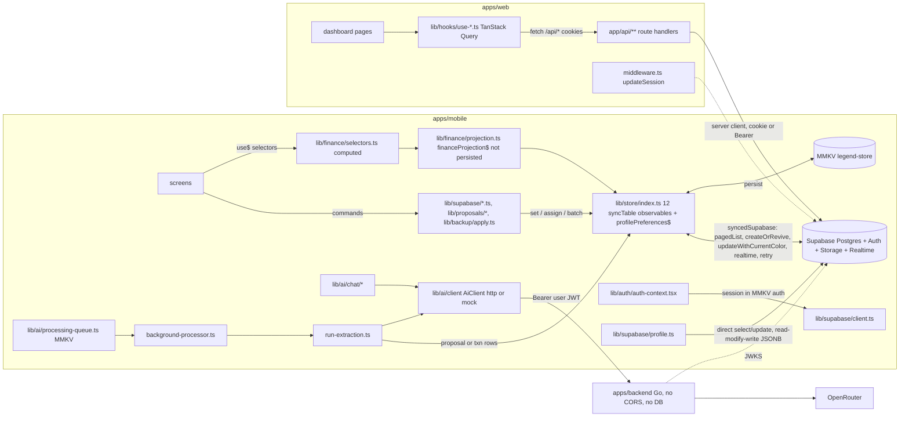

# Explore: data access, sync, auth and AI calls (web r1)

Read-only exploration, 2026-11-19. Repo at `1e67703`. Paths are relative to `/home/kaiz404/projects/moni`.

## TL;DR

- **Postgres holds almost no business rules.** There are no RPCs. Postgres has `updated_at` triggers, the profile-on-signup trigger, the category-name trigger, CHECK constraints, FKs and RLS. Every command rule lives in mobile TypeScript, and most of it is welded to Legend observables.
- **Many features compute over the whole ledger on the client**, for example recurring bills ("detected on-device, never stored"), routine and duplicate matching, budgets, net-worth lines, import dedupe and the chat snapshot. So the web needs the full ledger in memory either way. Paged server queries cannot reproduce bills without porting the detection to SQL.
- **The web API routes fail the deletion test.** Each has one caller, re-does what RLS already does, and holds rules that are wrong against today's schema. They ignore `deleted`, hard-delete rows, mix currencies and use a stale profile default. Delete them.
- **Recommendation: Option C.** Share the store module. Extract `packages/finance` (pure rules, read model, write plans) and `packages/data` (Supabase row gateway, Legend sync config, store factory). The persistence plugin (MMKV / IndexedDB-or-none) and the Supabase client (MMKV auth storage / `@supabase/ssr` cookies) are the two real adapters. Secret-key operations go to Supabase Edge Functions both apps call.

---

## 1. Current data paths

Notes:
- `QueryProvider` is mounted in `apps/mobile/app/_layout.tsx:136`, but nothing in mobile calls `useQuery` or `useMutation` (0 hits). It is dead weight.
- Mobile reads are local. `lib/supabase/wallets.ts#getWallets` computes balances in TS (`lib/supabase/balances.ts`, `lib/finance/ledger.ts#transactionDeltaMinor`) and never touches the `wallet_balances` view.
- The web reads balances from the `wallet_balances` view. That view does **not** filter `t.deleted = false` or `w.deleted` (`supabase/migrations/20261101000200_currency_text.sql:22-45`), so any soft-deleted transaction still moves the web balance. Phone and web disagree today.
- `apps/web/middleware.ts` sits at the app root while routes live in `src/app`. Next only picks up middleware beside `app/` (here `src/`), and Next 16 renames it `proxy.ts`. The auth redirect and cookie refresh probably never run. Verify with `next build` output.

## 2. How mobile reads and writes each table

| Table | Read | Write path | Notes |
|---|---|---|---|
| wallets | `wallets$` → projection → `walletsForUser$`, `walletBalanceMinor$` | `lib/supabase/wallets.ts` create/update/confirm/delete | delete cascades soft delete to its transactions client-side |
| transactions | `transactions$` → projection, `selectors.transactions$(filter)` | `lib/supabase/transactions.ts`, debt commands, approve, import | currency snapshot set client-side |
| categories | `categories$` + `hideShadowedPresets` | `lib/supabase/categories.ts` | duplicate name checked client-side and by trigger |
| tags, transaction_tags | synced, barely used | — | web still writes tags |
| category_budgets | `categoryBudgets$` | `lib/supabase/category-budgets.ts` upsert | `monthly_budget` lives in profile prefs |
| debts, debt_activities | synced | `lib/supabase/debts.ts#addActivity` writes 3 rows in one `batch` | cash mirror row in transactions |
| proposed_transactions | synced | `lib/supabase/proposed-transactions.ts`, `lib/proposals/*` | review state machine |
| recurring_overrides | synced | `lib/supabase/recurring-overrides.ts` | newest `updated_at` wins |
| auto_add_rules, merchant_aliases | synced once gated table found | own files | gated (`GATED_MIGRATIONS`) |
| profiles.preferences | `profilePreferences$` = `synced({get})`, no realtime, no set | `lib/supabase/profile.ts` direct PostgREST | read-modify-write of the whole JSONB: two devices clobber each other |
| storage `receipts` | — | `lib/receipts/upload-queue.ts` | path `{uid}/{id}.jpg` |

Sync mechanics, all in `apps/mobile/lib/store/index.ts`:
- `createOrRevive` turns a key clash into a revive of a soft-deleted row, or adopts the live row.
- `updateWithCurrentColor` rewrites legacy colours.
- `pagedList` pages around `max_rows`.
- `failWrite` retries only network errors.
- `GATED_MIGRATIONS` and `GATED_COLUMNS` probe the server, with `assertMigrated` and `isMigrated` for writers.
- `requeueLocalCreates` is a one-time repair.
- `clearStore` runs on sign-out.

None of these depend on React Native except `randomUUID` from `expo-crypto` and the MMKV plugin.

## 3. Business rules: where they live, and what the web must not re-type

"Pure" means no import of store, Supabase, RN, Expo or Legend (checked by grep). Everything pure can move to a shared package as is.

### In Postgres (the web gets these for free)
- RLS `auth.uid() = user_id` on every table. The system categories are read-only.
- `update_updated_at_column` triggers on every synced table. This drives mobile's `last-sync` pulls, so web writes reach phones automatically.
- `handle_new_user` creates the profile row (`20260214100000_add_profile_on_signup_trigger.sql`).
- `ensure_category_name_available`: active name unique per type and user scope (`20261101000100_malaysian_categories.sql`).
- CHECKs: amount > 0, a transfer has a target, location complete, currency ISO, icon and colour catalogues, `debt_activity_cash_shape`, `place_coords_at` needs `place_id`, `merchant_aliases.raw_key` format, bill `skip_period` format, proposal `status` values.
- UNIQUE `category_budgets(user_id, category_id, currency)` and `transaction_tags(transaction_id, tag_id)`.
- FK `ON DELETE CASCADE` to `auth.users`, which is the base for account deletion.
- The `wallet_balances` view, which is buggy (see above).

### Client-side only (the web would have to duplicate these unless shared)

| Rule | Where | Pure? |
|---|---|---|
| Transaction currency = source wallet currency (create, and on wallet change) | `lib/supabase/transactions.ts` createTransaction/updateTransaction | no (reads `wallets$`) |
| Transfer: wallets differ, same currency, amount > 0 | `transactions.ts#createTransfer`, `proposals/review-actions.ts#approve`, `proposed-transactions.ts#approveProposedTransaction` (three copies) | no |
| Debt-linked transactions are edited only from the debt | `transactions.ts#updateTransaction` | no |
| Soft delete only (`deleted=true`, never `DELETE`) | `transactions.ts#deleteTransaction`, everywhere | no |
| Wallet delete cascades soft delete to its transactions | `supabase/wallets.ts#deleteWallet` | no |
| `balance_confirmed_at` stamped on create and on balance view save | `wallets.ts` | no |
| Balance correction row (income/expense, `analysis_excluded`, `metadata.kind`) | `lib/wallets/balance-correction.ts#correctBalance` | **yes** |
| Wallet balance = initial + deltas | `lib/finance/ledger.ts`, `lib/supabase/balances.ts` | ledger yes |
| Review: approve, not mine, later (8 am tomorrow), undo, move back; decide only once | `lib/proposals/review-actions.ts`, `supabase/proposed-transactions.ts#closeProposal` | `editedProposal`, `retypeEdits`, `laterUntil` pure; the rest store-bound |
| Review history retention 30/90 days, prune | `proposed-transactions.ts` | no |
| Auto-add rule on "Don't ask about similar" (notification only, needs wallet and category, not after a retype) | `review-actions.ts#addSimilarRule`, `supabase/auto-add-rules.ts` | no |
| Routine detection, `merchantKey` | `lib/ai/routine.ts` | **yes** |
| Duplicate and transfer-pair matching | `lib/ai/duplicates.ts` | **yes** |
| Pairing: fold a capture, undo pairing | `lib/proposals/pairing.ts` | no |
| Debt activity: balance check, write-off must settle, wallet currency = debt currency, cash mirror txn type and description, status recompute | `lib/supabase/debts.ts#addActivity`, `cashType`, `debtStatus` | no (pure helpers are private) |
| Category duplicate name, only custom categories editable, delete = `is_active=false` | `supabase/categories.ts` | no |
| Bills: `billSeriesKey`, skip, due once | `supabase/recurring-overrides.ts`, `lib/finance/bills.ts`, `lib/ai/facts/recurring.ts` | bills and facts yes |
| Budget month, progress, monthly total fallback | `lib/finance/budget-month.ts` (pure), `selectors.ts#budgetProgress$` (logic inside `computed`) | partly |
| Finance timezone for month boundaries | `profile.ts#ensureFinanceTimezone`, `finance/dates.ts` | dates yes |
| Import: plan (dedupe against store), CSV and Moni-export decode | `lib/backup/plan.ts`, `csv.ts`, `generic-csv.ts`, `decode.ts`, `read-moni-export.ts` | **yes** |
| Import apply: parent-first, chunked, settle, strip gated columns, refresh debt status | `lib/backup/apply.ts` | no (Legend `syncState`) |
| Gated columns (`place_id`, `record_location`, `reviewed_at`, `pairing`) | `store/index.ts`, writers | no |
| Legacy colour rewrite | `store/index.ts` + `@repo/types#legacyColor` | yes in types |
| Chat answer cards and snapshot metrics | `ai/chat/answer-cards.ts`, `ai/snapshot/finance-metrics.ts`, `ai/facts/*` (pure); `ai/chat/answer-snapshot.ts`, `analyze.ts` (store-bound) | mixed |
| Row → domain adapters (decimal → minor, timestamps, metadata parse) | `lib/finance/adapters.ts` (pure) **and** 22 hand-written `*Row` types with `map*Row` in `lib/supabase/*.ts` | duplicated inside mobile already |

About 60 files under `lib/finance`, `lib/ai`, `lib/proposals`, `lib/capture`, `lib/backup`, `lib/wallets` and `lib/transactions` are already pure. About 30 files import `@/lib/store`.

**What the web must not duplicate:** every row in the table above. The current web routes already re-type three of them (currency snapshot, transfer currency, partial row mapping) and drift on the rest.

## 4. Web API route audit (`apps/web/src/app/api/**`)

The deletion test asks: if a route disappears, does its complexity reappear across many callers? Each route has exactly one caller (a hook in `src/lib/hooks/`). Its auth check and `.eq('user_id')` repeat what RLS already enforces. So the routes are pass-throughs, not depth.

| Route | What it adds over direct supabase-js + RLS | Staleness and bugs | Verdict |
|---|---|---|---|
| `GET/POST /api/transactions` | filter and paging params, row → DTO, currency snapshot, transfer currency check | **No `deleted=false` filter.** No debt-link guard. Casts like `t as typeof t & {currency?}` show the types are stale. Search string goes raw into `.or()` (filter injection). Not paged past `max_rows` for exports. | delete; rules move to the shared write plan |
| `PUT/DELETE /api/transactions/[id]` | currency re-snapshot, transfer check, tag replace | **`DELETE` hard-deletes**: phones never learn of it through `last-sync` pulls. Can edit debt-linked rows. | delete |
| `GET/POST /api/wallets`, `[id]` | reads `wallet_balances` | Balance includes soft-deleted txns (view bug). DELETE sets `is_active=false` while mobile uses `deleted=true` + cascade. Create skips `balance_confirmed_at`. Allows a currency change that orphans snapshots. | delete |
| `GET/POST /api/categories` | `.or(user_id.is.null, …)` | Ignores `deleted`. No `hideShadowedPresets`. | delete |
| `GET/POST /api/tags` | — | Tags are unused in the redesign. | delete |
| `GET /api/analytics/overview` | the only route with logic | Sums **across currencies** as floats. Uses the server timezone, not `finance_timezone`. Includes deleted and `analysis_excluded` rows. `topCategory` TODO. Disagrees with mobile `financeOverview$`. | delete; use the shared selectors |
| `POST /api/auth/login`, `register`, `logout` | wraps `signInWithPassword` and `signUp` | `register` inserts a profile the trigger already made, with `currency: 'USD'` (default is MYR since `20261021000000`). Returns raw tokens in JSON. | delete; call `supabase.auth` from the browser client |
| `GET/PUT /api/auth/profile` | — | PUT replaces the whole `preferences` JSON, wiping `default_wallet_id`, `monthly_budget` and `finance_timezone`. | delete; shared `updatePreferences` (patch) |
| `GET /auth/callback` | PKCE `exchangeCodeForSession` into cookies | fine | **keep**: needed for Google OAuth and magic-link on web |

What direct access does **not** give, which is where server code earns its place:
1. **Secret-key operations**: account deletion, QR sign-in token minting. Mobile also needs these, and "mobile never calls web" rules out Next routes for them. They belong in Supabase Edge Functions.
2. **SSR first paint with cookies**: `@supabase/ssr` server client in Server Components. Useful for the auth gate and landing page. Low value for the dashboard, because the ledger has to load into the browser anyway (section 3).
3. **AI calls**: the Go backend has no CORS middleware (`grep cors apps/backend` = 0). Either add a CORS allowlist for the web origin (preferred, keeps one `AiClient` contract), or proxy through a route handler (adds a hop and a second error mapping).

## 5. Seam options

### Option A: one `FinanceStore` interface; the Legend adapter on the phone, the TanStack adapter on the web
- The interface would need reactive reads for every selector (about 20 in `selectors.ts`), commands, sync status, gated migrations and sign-out reset.
- The TanStack implementation re-does paging, incremental `updated_at` pulls, realtime merge, soft-delete merge and revive. All of that already exists in `store/index.ts`.
- Reads cannot share code: Legend `computed` vs `useQuery` + `select`.
- **Shallow**: the interface is nearly as wide as the implementation. Two implementations of every read mean duplication by construction. Reject.

### Option B: shared pure rules + write plans + Supabase row gateway; each app keeps its own cache
- `packages/finance`: pure rules from section 3, the row↔domain adapters, and selectors rewritten as plain functions over `FinanceProjection`. Commands become **write plans**: `approveProposal(view, proposal, edits, now) → { writes: RowWrite[] } | needsInput | error`, where `RowWrite = insert | patch | softDelete` on a typed table.
- `packages/data`: `createOrRevive`, `updateRow`, `pagedList` and `softDelete`, parameterised by a `SupabaseClient`. Mobile's Legend hooks call them. The web writer calls them directly.
- Applying writes is the seam. Real adapters: the Legend applier on the phone (`batch` set/assign) and the supabase-js applier on the web. The in-memory applier in tests is a third. That makes it a real seam.
- Web cache: TanStack Query, either holding the full ledger (and then re-implementing the incremental pull and realtime merge) or doing server-side queries. Server-side queries cannot show bills, routine or duplicates without porting detection to SQL.
- **Pros**: smallest conceptual change to mobile. Tests become plain input→output.
- **Cons**: the web still re-builds a sync cache. Two caches can disagree on soft-delete or revive edge cases.

### Option C (recommended): Option B's packages, plus the Legend store itself shared; persistence and the client are the adapters
- `packages/data/store.ts` exports `createMoniStore({ supabase, persist, uuid })` and returns the 12 observables plus `enableStoreSync`, `clearStore` and `isMigrated`. Mobile passes the MMKV plugin. Web passes `ObservablePersistIndexedDB` from `@legendapp/state/persist-plugins/indexeddb` (bundled in 3.0.0-beta.47), or no persistence at first: an in-memory store with a full paged pull on load, about 1–2 MB for a heavy user.
- Two real adapters for persistence (MMKV, IndexedDB) and for the Supabase client (`createClient` with MMKV auth storage, `createBrowserClient` with cookies).
- The web then gets the same projection, the same `computed` selectors (`use$` works in client components) and the same commands. Desktop tables page and sort over `FinanceProjection` in memory, as mobile's `activity-filter.ts` does.
- **Pros**: no rule or sync logic exists twice. Web edits show on the phone through the existing realtime and `last-sync` paths. Import, bulk edit and chat "act on many rows" all reuse the write-plan path.
- **Cons and mitigations:**
  - No SSR for ledger data. Keep SSR for the landing page, auth and the shell.
  - Bulk writes: `syncedSupabase` issues one request per changed row. `apply.ts` already chunks and settles. For 1k+ rows, the web applier can use the gateway's `upsertMany` and let realtime refresh the store.
  - Multi-tab: give each tab its own in-memory store, or one IndexedDB DB per tab. Realtime keeps tabs coherent.
  - Legend v3 is beta on both platforms, so the risk is already accepted.
  - Platform side effects inside commands (`recordSourceLinked`, `refreshLinkedPackagesFromStore`, `markCaptureStatus`, `keepProposalReceipt`, `emitProposedTransactionsChanged`) must leave the commands. See candidate 2.

Option C is a superset of B. Building B's packages first is the prerequisite either way, so the choice between B and C for the web cache can be made after step 1 without wasted work.

## 6. Auth

- **Client factory**: one `createMoniSupabase(kind)` in `packages/data`. Mobile uses `createClient` with `authMMKV` and `detectSessionInUrl: false` (`apps/mobile/lib/supabase/client.ts`). The web uses `@supabase/ssr` `createBrowserClient` and `createServerClient` (`apps/web/src/lib/supabase/*`). The store factory takes the client, so nothing imports a singleton.
- **Session lifecycle** is shared logic: `authReady$`, `enableStoreSync` on sign-in, and the sign-out order (`authReady$=false` → clear queue → `clearStore` → `supabase.auth.signOut`, in `apps/mobile/lib/auth/auth-context.tsx:121-130`). Move it to one `signOutEverywhere(effects)` with platform effects injected (the Android queue and bill reminders on mobile, nothing on web). Web `auth-context.tsx` currently only calls `signOut`. It never clears any cache.
- **Google sign-in**: no shared code beyond the client. Mobile uses the native ID token with `signInWithIdToken` (`lib/auth/google-signin.ts`). Web uses `signInWithOAuth({ provider: 'google', redirectTo: /auth/callback })`, and the existing callback route handles PKCE. Same Supabase Google provider; add the web origin to the redirect allowlist.
- **QR sign-in** (board W2-Auth: "Sign in with your phone … New code in 0:42 … Profile › Scan to sign in"): this needs a secret key, so it runs as Supabase Edge Functions and a small table.
  1. The web calls `qr-start` without auth. It gets `{ requestId, pollSecret, code, expiresAt }` and shows a QR for `moni://sign-in?code=…`. The code rotates every 60 s.
  2. The phone scans, shows "Sign in on <browser, city>?" and calls `qr-approve` with its JWT and the code. The function runs `auth.admin.generateLink({ type: 'magiclink', email })` and stores the `hashed_token` against the request, single use.
  3. The web polls `qr-poll` with `pollSecret`, gets the token hash once, and calls `supabase.auth.verifyOtp({ token_hash, type: 'magiclink' })`, which sets the cookie session.
  - Short TTL, delete on read, rate limit per IP. The Go backend can't host this because it has no DB. A Next route can't either, because mobile would then call web.
- **Account deletion (#56)**: an Edge Function `delete-account`. It verifies the JWT, deletes the `receipts/{uid}/` objects through the Storage API, then runs `auth.admin.deleteUser(uid)`. Every user table cascades from `auth.users`. Supabase blocks direct SQL deletes on `storage.objects`, so a SQL RPC alone is not enough. Both apps call one shared `deleteAccount(supabase)` and then the shared sign-out. The public deletion page for Play is a static web route that leads to sign-in and then the same function.
- **AI opt-in (#57)**: store consent outside the `preferences` JSONB, because that JSONB is read-modify-write and races across devices. Use a `profiles.ai_consent_at timestamptz` + `ai_consent_version`, or an append-only `ai_consents` table for the consent record. Enforce it in two places:
  - a client gate in the shared `AiClient` wrapper (returns `{ status: 'unavailable', reason: 'consent' }`);
  - a server gate that keeps Go stateless: a Supabase **Custom Access Token Hook** adds `ai_consent: true` to the JWT, and the Go auth middleware rejects extract and chat calls without it. After toggling, call `supabase.auth.refreshSession()` so the claim updates at once.

## 7. Generated database types

- **Today:** the web has a hand-patched `apps/web/src/lib/database.types.ts`. It knows 6 public tables plus the view, with no `deleted` column and none of `proposed_transactions`, `debts`, `category_budgets`, `recurring_overrides`, `auto_add_rules` or `merchant_aliases`, but someone added `place_id` by hand (commit `cd4b58a`). Mobile has no generated types at all, only 22 hand-written `*Row` types in `lib/supabase/*.ts`.
- **Proposal:** one generated file, `packages/types/src/database.ts` (exported as `@repo/types/database`), produced by `supabase gen types typescript --linked --schema public` behind a root `pnpm gen:db-types` script. Both apps import `Tables<'transactions'>`, and Legend's `syncedSupabase` accepts the `Database` generic. Delete the web copy and the 22 mobile row types. A CI drift check regenerates the file and fails on a diff, for example `supabase db start` in CI or a check that the newest migration timestamp is listed in a header comment.
- Gated columns stay a runtime concern (`isMigrated`). The types describe the target schema.

## 8. Deepening candidates

### 1. Write plans: ledger commands become pure plans behind one applier
- **Files:** `lib/supabase/transactions.ts`, `debts.ts`, `wallets.ts`, `categories.ts`, `proposed-transactions.ts`, `lib/proposals/review-actions.ts`, `pairing.ts`, `lib/backup/apply.ts`.
- **Problem:** rules are interleaved with `wallets$.peek()` and `patchRow`. The transfer rule exists three times. Tests must `jest.mock('@/lib/store')` with fake observables (19 files do).
- **Deep interface:** `plan(command, view, now, ids) → Result<RowWrite[]>`, plus one `apply(writes)`. `view` is a narrow read-only lookup: wallet by id, open proposal, debt activities.
- **Locality:** each rule lives once, next to its siblings. Changing the transfer rule touches one function.
- **Leverage:** web, bulk edit, import and Moni chat batch actions all reuse the same plans.
- **Tests:** plans become table tests with no mocks. One applier contract test runs against the Legend, supabase-js (dev project) and in-memory adapters.

### 2. Commands stop calling platform effects
- **Files:** `wallets.ts` (`recordSourceLinked`, `refreshLinkedPackagesFromStore`), `proposed-transactions.ts#closeProposal` (`markCaptureStatus`, `clearProposalLocationSnapshot`, `emitProposedTransactionsChanged`), `review-actions.ts` (`keepProposalReceipt`), `backup/apply.ts`.
- **Problem:** Android-only concerns sit inside ledger commands, which blocks sharing them.
- **Deep interface:** the mobile shell observes the store. For example, the linked-package cache is derived with `observe(wallets$)`, and capture status follows from proposal status changes. A command's result names what happened (`approved {transactionId}`) and the mobile wrapper reacts.
- **Locality:** notification logic lives in `lib/notifications` only.
- **Leverage:** commands run unchanged on the web.
- **Tests:** command tests drop the `capture-status` and `linked-packages` mocks. Notification tests assert derived state.

### 3. Store factory with injected client and persistence (`packages/data`)
- **Files:** `lib/store/index.ts`, `store/auth-sync.ts`, `store/helpers.ts`, `lib/supabase/client.ts`, `lib/mmkv/legend-store`.
- **Problem:** module-level singletons import the Expo client, MMKV and `expo-crypto`, so the web cannot import them.
- **Deep interface:** `createMoniStore({ supabase, persist, uuid })` returns the observables plus `enableStoreSync`, `clearStore`, `isMigrated` and `assertMigrated`. It hides paging, revive, colour rewrite, retry policy, gated probes and the create-repair. Adapters: MMKV / IndexedDB-or-memory, and the Expo client / SSR browser client.
- **Locality:** sync fixes such as the `max_rows` paging or the CHAR(3) lesson land once.
- **Leverage:** the web inherits offline-tolerant, realtime, soft-delete-correct sync.
- **Tests:** the existing store tests run against the in-memory persist adapter. Add one web smoke test that pulls the e2e seed.

### 4. One read model: plain selectors over `FinanceProjection`
- **Files:** `lib/finance/selectors.ts` (logic inside `computed`, for example `budgetProgress$` and `netWorthByCurrency$`), `projection.ts`, `adapters.ts`, `map*Row` in `lib/supabase/*.ts`, web `analytics/overview`.
- **Problem:** row mapping exists twice in mobile (`adapters.ts` vs `mapTransactionRow` and `mapWalletRow`) and a third time in the web routes. Selector logic can't run outside Legend.
- **Deep interface:** `packages/finance` exports `budgetProgress(projection, month, tz)`, `netWorth(projection)` and so on as plain functions. `selectors.ts` shrinks to `computed(() => budgetProgress(financeProjection$.get(), …))`.
- **Locality:** one definition of "balance", "spent this month" and "analysis excluded".
- **Leverage:** web tables and charts and the chat snapshot (`answer-snapshot.ts`) use the same numbers as the phone. This also removes the `wallet_balances` view dependency and its deleted-rows bug.
- **Tests:** selector tests stop needing `reactivity.test.tsx`-style setup for logic. Reactivity is tested once.

### 5. `AiClient` as a shared factory with a consent gate
- **Files:** `lib/ai/client/http-client.ts`, `config.ts`, `types.ts`, `index.ts`, `apps/backend/internal/auth`.
- **Problem:** the client reads `EXPO_PUBLIC_*` and lazily imports the Expo Supabase client. The Go backend has no CORS. Consent is not modelled.
- **Deep interface:** `createAiClient({ baseUrl, getAccessToken, consent })` returns the existing `AiClient`. It never throws, and adds the `unavailable: consent` result. `http` and `mock` are already two adapters, so this is a real seam. The web becomes a third caller of the same `http` adapter.
- **Locality:** timeout, error mapping and the consent check live in one place.
- **Leverage:** web chat, web import "read with AI" and mobile share one wire contract. That also helps the manual `types.ts` ↔ `types.go` sync.
- **Tests:** the existing client tests are parameterised by `getAccessToken`. Add a backend test that a JWT without the `ai_consent` claim gets 403.

## 9. Suggested order

1. Generate the DB types into `@repo/types/database`. Delete the web routes and hooks; nothing else consumes them.
2. Fix the `wallet_balances` view (`deleted = false` on both sides) or drop it once nothing reads it. Check the middleware location.
3. Do candidates 4 and 1 (pure read model and write plans) inside mobile first, behind the existing call sites. Mobile tests prove no behaviour change.
4. Do candidates 2 and 3 (strip effects, store factory) and move the code to `packages/finance` and `packages/data`.
5. Web: mount `createMoniStore` with the browser client and memory persistence, and render the desktop screens from shared selectors and plans.
6. Edge Functions for `delete-account` and the QR flow, the custom access token hook for AI consent, and CORS on Go.
